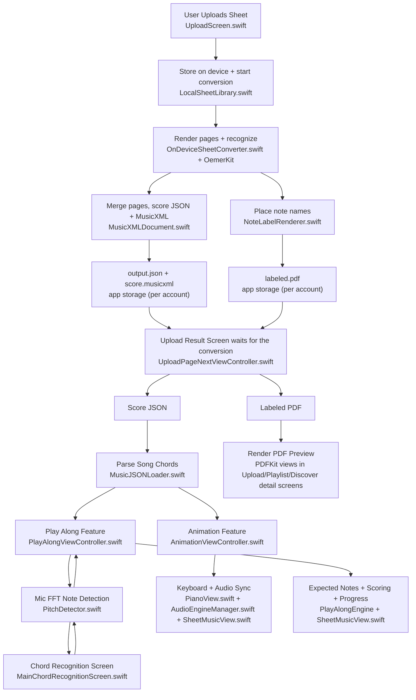
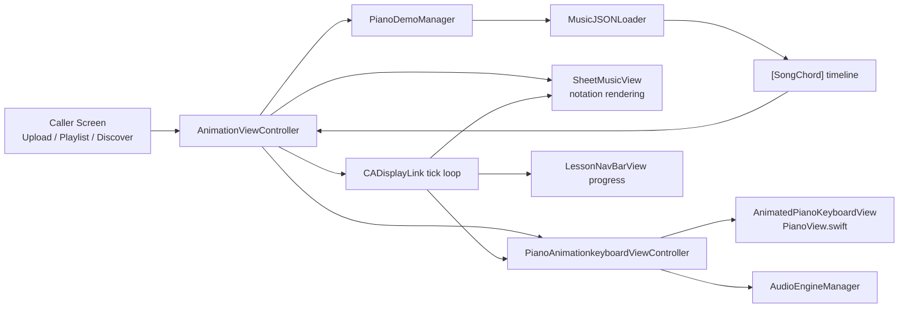

# Re-Hearse Core Features: Easy but Detailed Architecture Guide

This guide explains how the 4 core features work in the current codebase, with a focus on:

- which file starts each feature
- which files contain the actual logic
- what data goes in and out
- where to edit safely when you want to change behavior

Features covered:

1. Animation
2. Play Along
3. Note Labelling
4. Chord Recognition

---

## How to Read This Document

If you are new to the project, use this order:

1. Read `Quick Map` for top-level ownership.
2. Read `Shared Core Files` to understand what is reused.
3. Read each feature section:
   - `What it does`
   - `Main files`
   - `Runtime flow`
   - `Where to edit`
   - `Things that look legacy`

---

## Quick Map (Most Important Files Per Feature)

| Feature | Main controller file(s) | Core logic file(s) |
| --- | --- | --- |
| Animation | `Screens/PianoAnimation/AnimationViewController.swift` | `Screens/PianoAnimation/MusicJSONLoader.swift`, `Screens/PianoAnimation/SheetMusicView.swift`, `Screens/PianoAnimation/PianoView.swift` |
| Play Along | `Screens/PlayAlong/PlayAlongViewController.swift` | `PlayAlongEngine` inside same file, `Components/PitchDetector.swift`, `Models/PianoDataManager.swift` |
| Note Labelling | `Screens/Upload/UploadPageNextViewController.swift` | `Services/SheetMusic/OnDeviceSheetConverter.swift`, `Services/SheetMusic/NoteLabelRenderer.swift`, `Services/SheetMusic/LocalSheetLibrary.swift`, `OemerKit/` |
| Chord Recognition | `Screens/ChordRecognition/MainChordRecognitionScreen.swift` | `Components/PitchDetector.swift` (active live logic) |

---

## End-to-End Flow Diagram

---

## Shared Core Files (Used by Multiple Features)

These files are cross-feature foundations:

| File | Why it matters |
| --- | --- |
| `Screens/PianoAnimation/MusicJSONLoader.swift` | Converts converted-sheet JSON into timed note groups (`SongChord`). Used by Animation + Play Along. |
| `Screens/PianoAnimation/SongChord.swift` | Shared note-group model (`leftHandNotes`, `rightHandNotes`, `duration`, `globalTick`). |
| `Screens/PianoAnimation/SheetMusicView.swift` | Draws sheet notation and keeps scroll position in sync with ticks/progress. |
| `Screens/PianoAnimation/PianoView.swift` | Main keyboard UI (`AnimatedPianoKeyboardView`) for both Animation + Play Along. |
| `Screens/PianoAnimation/AudioEngineManager.swift` | Shared sound playback system (AVAudioEngine + sampler). |
| `Components/PitchDetector.swift` | Shared mic + FFT detector (used in Play Along and Chord Recognition). |
| `Models/PianoDataManager.swift` | Converts parsed chords into play-along groups. |

---

## 1) Animation

### What this feature does

Animation is the full “auto-play + visualize” mode for converted sheet music.  
Given converted JSON from upload/discover/playlist flows, it:

- parses note/chord timing
- draws and scrolls notation
- highlights keys by hand (left/right)
- plays notes through the piano engine
- keeps all three surfaces in sync:
  - audio
  - keyboard animation
  - sheet position

### Core architecture (at a glance)

### Main files and exact responsibilities

| File | Responsibility |
| --- | --- |
| `Screens/PianoAnimation/AnimationViewController.swift` | The orchestrator. Owns playback state machine, chord indexing, seeking, tempo changes, progress math, display loop, orientation handling, and UI overlays/settings. |
| `Screens/PianoAnimation/PianoAnimationkeyboardViewController.swift` | Keyboard+audio execution layer for each chord event. Highlights left/right notes, manages hand labels, and schedules note-off timing for articulation clarity. |
| `Screens/PianoAnimation/MusicJSONLoader.swift` | Converts the score JSON (MusicXML as JSON, written by the on-device converter; Discover songs use the same layout) into a normalized timed sequence (`SongChord`) with stable `globalTick` and computed durations. |
| `Screens/PianoAnimation/PianoDemoManager.swift` | Simple loader/iterator over `SongChord` data; decouples source data from playback controller. |
| `Screens/PianoAnimation/SheetMusicView.swift` | Pure rendering layer for notation and tick-based scroll positioning. |
| `Screens/PianoAnimation/PianoView.swift` | UI implementation of full keyboard (`AnimatedPianoKeyboardView`, `AnimatedPianoKeyView`) including hand color cues and animations. |
| `Screens/PianoAnimation/AudioEngineManager.swift` | Sound generation and note lifecycle (note-on/off, instrument switching, engine sessions). |
| `Screens/PianoAnimation/TopView.swift` | `LessonNavBarView` (back/menu/progress slider) used by Animation. |
| `Screens/PianoAnimation/SongChord.swift` | Data contract for one playable event (left notes, right notes, duration, tick). |

### Entry points into Animation

| File | Launch path |
| --- | --- |
| `Screens/Upload/UploadPageNextViewController.swift` | Uses freshly converted JSON from upload pipeline. |
| `Screens/Playlist/SongDetailsPage.swift` | Launches from playlist song detail with fetched converted JSON. |
| `Screens/Discover/DiscoverSongDetailViewController.swift` | Launches from discover song detail with fetched converted JSON. |

### Data contract used by Animation

`AnimationViewController` receives:

- `sheetMusicData: Data?` (converted JSON bytes)
- `songTitle: String` (UI label only)

Converted JSON is parsed into `[SongChord]`:

- `leftHandNotes: [String]`
- `rightHandNotes: [String]`
- `duration: Double`
- `globalTick: Int`

This means Animation is tick-driven but plays in wall-clock time.

### Detailed runtime flow (controller lifecycle)

1. `viewDidLoad`
   - builds layout (`sheetCard`, piano child VC, overlay, nav bar)
   - wires callbacks (back, seek, tempo, menu)
   - calls `loadChords()`
2. `loadChords()`
   - chooses data source (`sheetMusicData` or debug fallback)
   - uses `PianoDemoManager` -> `MusicJSONLoader` to parse chords
   - computes `totalDuration`
   - loads same JSON into `SheetMusicView`
3. `viewWillAppear`
   - hides tab/nav bars
   - forces landscape
4. `startPlayback()`
   - validates chord list
   - creates `CADisplayLink`
   - toggles overlay/UI states
5. `tick(_:)` each frame
   - determines current chord
   - computes adjusted duration by tempo
   - interpolates current tick position for sheet
   - updates nav progress
   - triggers keyboard/audio when entering new chord
6. `stopPlayback(reset:)`
   - invalidates display link
   - stops notes
   - optionally resets chord index and sheet progress
7. `viewWillDisappear`
   - stops playback and restores portrait orientation

### Timing and synchronization internals

Animation keeps several timing variables:

- `chordIndex`: current chord position
- `elapsedInChord`: elapsed wall time inside current chord
- `elapsedTotal`: elapsed wall time across whole song
- `totalDuration`: sum of chord durations at base tempo
- `tempoMultiplier`: live playback multiplier

Important behavior:

1. Chord duration is tempo-adjusted at runtime:
   - `adjDuration = chord.duration / tempoMultiplier`
2. Sheet position uses interpolated tick between current and next chord:
   - smooth movement instead of jumping per chord
3. Progress updates are tied to absolute wall-time accumulation (`elapsedTotal`)
4. Seek recalculates both:
   - timeline index/state
   - sheet tick interpolation state

This is why sync stays stable even after repeated seek + tempo changes.

### Seek behavior (critical implementation details)

Seek has 2 paths:

- double-tap shortcuts (`seekBy(-5)` and `seekBy(5)`)
- slider scrub (`seekToProgress(...)`)

Both paths:

1. locate correct chord index for target time
2. recompute local elapsed time in chord
3. recompute absolute elapsed total
4. reset keyboard/audio current sounding state
5. update sheet by interpolated tick immediately
6. update nav progress

This prevents the common bug where audio, sheet, and progress drift after scrubbing.

### Tempo behavior

Tempo changes come from menu callbacks and set `tempoMultiplier`.

Effects:

- shorter/longer effective chord durations during tick loop
- progress still mapped against absolute song duration
- seek math compensates to avoid misalignment

Tempo range is constrained in `SettingsMenuView` to keep behavior predictable.

### UI components inside Animation runtime

`AnimationViewController` directly manages multiple UI systems:

- `LessonNavBarView` from `TopView.swift`
  - back button
  - progress slider
  - menu button
- `PlaybackOverlay`
  - play/pause center control
  - double-tap seek visual feedback
- `SettingsMenuView`
  - tempo controls
  - instrument selector (via `AudioEngineManager.switchInstrument`)

Because these are tightly coupled to playback state, most are intentionally kept in/near the controller file.

### Audio path details

Audio playback path:

1. `AnimationViewController` enters new chord
2. calls `PianoAnimationkeyboardViewController.playChord(...)`
3. keyboard VC highlights keys
4. keyboard VC sends note-on/note-off to `AudioEngineManager`
5. `AudioEngineManager` uses sampler/soundfont or fallback tone path

`PianoAnimationkeyboardViewController` also cancels pending note-off tasks before new chord attacks to reduce muddy overlap.

### JSON parsing details that affect Animation quality

`MusicJSONLoader` does several important normalization steps:

- reads divisions and tempo from JSON metadata
- tracks local measure ticks with staff/voice separation
- applies backup behavior correctly inside measure timing
- converts events to global ticks
- groups simultaneous notes into one `SongChord`
- computes chord duration primarily from distance to next tick

This logic is why converted scores play with stable event spacing instead of collapsing into too-few events.

### Where to edit for specific Animation changes

| Goal | Start editing here |
| --- | --- |
| Fix drift between sheet and audio | `Screens/PianoAnimation/AnimationViewController.swift` (`tick`, `seekBy`, `seekToProgress`) |
| Improve rhythm/timing parse from JSON | `Screens/PianoAnimation/MusicJSONLoader.swift` |
| Change notation movement behavior | `Screens/PianoAnimation/SheetMusicView.swift` |
| Change key highlight style/hand colors | `Screens/PianoAnimation/PianoView.swift` |
| Change note articulation/attack/release feel | `Screens/PianoAnimation/PianoAnimationkeyboardViewController.swift` |
| Change instrument/sound rendering | `Screens/PianoAnimation/AudioEngineManager.swift` |
| Change nav/slider/menu UI | `Screens/PianoAnimation/TopView.swift` and `AnimationViewController.swift` |

### Debug checklist for Animation issues

If animation “looks wrong”, use this quick path:

1. No notes playing:
   - check `AudioEngineManager` session acquired/released correctly
   - verify `playChord(...)` gets non-empty notes
2. Sheet not moving:
   - verify `tick(_:)` runs
   - verify `sheetCard.updateToTick(...)` receives changing tick
3. Slider/progress mismatch:
   - inspect `elapsedTotal` vs `totalDuration`
   - inspect `seekToProgress(...)` recalculation path
4. Wrong chord density/timing:
   - inspect `MusicJSONLoader.parse(...)` event grouping and duration calc
5. Stuck orientation:
   - inspect `viewWillAppear/viewWillDisappear` orientation update paths

### Animation-specific risks and gotchas

- Playback state is distributed across multiple timing variables, so partial edits can break sync if only one variable is updated.
- Seek changes must update both musical position and wall-time accumulators.
- Tempo and seek logic are coupled; test both together.
- UI overlay gestures can conflict with nav slider interaction if hit-testing rules are changed.

### Files near Animation that look non-core/legacy

| File | Note |
| --- | --- |
| `Common/Music_Components/AnimatedKeyboardView.swift` | Older demo keyboard component; not the active Animation keyboard. |
| `Common/Music_Components/PianoKeyView.swift` | Supports the older demo component above. |
| `Screens/PianoAnimation/PianoLogic.swift` | Contains chord utility logic, but not in the active Animation playback runtime path. |

---

## 2) Play Along

### What this feature does

Play Along is a guided practice mode:

- shows expected notes
- listens to user notes (mic or keyboard)
- marks correct vs wrong notes
- advances through score groups
- tracks progress and session report

### Main files and responsibilities

| File | Responsibility |
| --- | --- |
| `Screens/PlayAlong/PlayAlongViewController.swift` | Main screen + orchestration. Handles loading, mic permission, session lifecycle, callbacks, and finish reporting. |
| `PlayAlongEngine` (inside same file) | Core rule engine for expected notes, matching logic, progression, scoring, tempo pulse, seek, and finish conditions. |
| `Components/PitchDetector.swift` | Mic capture + FFT note detection input to Play Along. |
| `Models/PianoDataManager.swift` | Converts parsed `SongChord` sequence into grouped note targets. |
| `Screens/PianoAnimation/MusicJSONLoader.swift` | Parses JSON into timed `SongChord` data used by Play Along. |
| `Screens/PianoAnimation/SheetMusicView.swift` | Notation display + progress updates + wrong-note markers. |
| `Screens/PianoAnimation/PianoView.swift` | Hinting keyboard and on-screen input surface. |
| `Screens/PianoAnimation/AudioEngineManager.swift` | Optional key sound output for interactions. |

### Where Play Along gets launched

| File | Launch path |
| --- | --- |
| `Screens/Upload/UploadPageNextViewController.swift` | Launch from freshly converted upload. |
| `Screens/Playlist/SongDetailsPage.swift` | Launch from playlist song detail. |
| `Screens/Discover/DiscoverSongDetailViewController.swift` | Launch from discover song detail. |

### Runtime flow (step-by-step)

1. Caller passes converted JSON to `PlayAlongViewController.sheetMusicData`.
2. `loadSheetDataIfNeeded()` parses JSON via `MusicJSONLoader.loadSongChords(from:)`.
3. Controller loads same JSON into `SheetMusicView`.
4. Parsed sequence is passed to `PlayAlongEngine.start(with:)`.
5. `PlayAlongEngine` converts chords to playable groups via `PianoDataManager`.
6. Engine sends current expected notes and progress through delegate.
7. Controller updates nav text, hints on keyboard, and sheet progress.
8. User input sources:
   - mic path: `PitchDetector` -> detected notes
   - keyboard path: on-screen key taps
9. `handleInput(note:)` calls `engine.processNote(note)`.
10. Correct note:
   - removes note from expected set
   - once group complete, advances to next group
11. Wrong note:
   - increments mistakes
   - triggers visual feedback + persistent wrong marker on sheet
12. Final group complete -> engine sends finish callback -> report view appears.

### Where to edit when changing Play Along

| Change needed | Primary file to edit |
| --- | --- |
| Match/scoring rules, progression, debounce | `Screens/PlayAlong/PlayAlongViewController.swift` (`PlayAlongEngine` section) |
| Mic behavior and detection robustness | `Components/PitchDetector.swift` |
| Note group structure | `Models/PianoDataManager.swift` |
| Hint drawing and keyboard visuals | `Screens/PianoAnimation/PianoView.swift` |
| Sheet feedback markers | `Screens/PianoAnimation/SheetMusicView.swift` |

### Important design note

Play Along logic is intentionally concentrated in one file today:

- `PlayAlongViewController`
- `PlayAlongEngine`
- `PlayAlongNavBar`
- `PlayAlongReportView`

This makes onboarding easy (single file), but long-term refactors may split it for maintainability.

---

## 3) Note Labelling

### What this feature does

Note Labelling runs entirely on the device. For every upload it:

- reads the sheet music on each page with OemerKit (Core ML + the oemer engine in Swift)
- produces the score JSON used by Animation and Play Along, and MusicXML
- writes English note names (like `C4`, `A#4`, `Bb3`) under the notes onto a copy of the
  uploaded PDF
- keeps everything in the app's storage, per account

Nothing is uploaded and there is no job to poll; the result screen waits for the conversion
running in the app.

### Files and responsibilities

| File | Responsibility |
| --- | --- |
| `Screens/Upload/UploadScreen.swift` | Upload entry (scan, photo, library, PDF): builds the PDF and adds it to `LocalSheetLibrary`, then opens the result screen. |
| `Screens/Upload/UploadPageNextViewController.swift` | Result screen: shows conversion progress, then the labeled PDF, key/tempo/chords, and unlocks Animation/Play Along. Refresh retries a failed conversion. |
| `Screens/Upload/AllUploadsViewController.swift` | All uploads on the device: open, rename, delete, retry. |
| `Screens/Playlist/SongDetailsPage.swift` | Opens an upload added to a playlist (`track_id = "local-upload:<uuid>"`) from the device; Discover songs from Supabase. |
| `Services/SheetMusic/LocalSheetLibrary.swift` | Stores uploads and results per account, runs conversions (they continue when you leave the screen), progress, retry, resume after the app was closed. |
| `Services/SheetMusic/OnDeviceSheetConverter.swift` | Pipeline: render each PDF page, run OemerKit, merge pages, write score JSON, MusicXML and the labeled PDF. |
| `Services/SheetMusic/NoteLabelRenderer.swift` | Label placement and drawing. |
| `Services/SheetMusic/MusicXMLDocument.swift` | MusicXML parse/merge/write, and conversion to the app's score JSON. |
| `OemerKit/` | The recognizer (local Swift package): note names, rhythm, and where each note and its staff are on the page. |

### End-to-end runtime flow

1. `UploadScreen` creates a PDF from the scan/photo (612×792 pt pages) or takes the picked PDF.
2. `LocalSheetLibrary.add(...)` saves `input.pdf` and starts a conversion task.
3. `OnDeviceSheetConverter.convert(...)`, per page:
   - renders the page at ~4 MP
   - `SheetMusicRecognizer.recognize(cgImage:)` (OemerKit) returns MusicXML and the located notes
   - `NoteLabelRenderer.layout(...)` places the labels
4. Pages are merged (measures renumbered); the converter writes `output.json` (score JSON),
   `labeled.pdf` (original pages + labels) and `score.musicxml`.
5. `UploadPageNextViewController` shows progress, then the labeled PDF; its JSON feeds
   Animation and Play Along.

### How labels are placed (`NoteLabelRenderer`)

1. Label text is OemerKit's note name: step + `#`/`b` + octave (`C#4`, `Bb3`).
2. Labels are grouped by system and staff, and sorted left to right.
3. Font size is 1.3 × the staff's line spacing; the baseline is 2.5 spacings below the staff's
   bottom line.
4. If that line would cover a notehead of the same staff (notes on ledger lines below it), the
   label starts below the lowest such notehead instead.
5. A label within 2.2 label heights (horizontally) of one already placed moves down by 1.8
   label heights, so chord names stack.
6. Labels are drawn in black Helvetica on top of the original PDF page; positions are converted
   from page-image pixels to PDF points.

### Where to edit when changing Note Labelling

| Change needed | Primary file to edit |
| --- | --- |
| Label text format (`Bb4`, `C#5`, etc.) | `Services/SheetMusic/NoteLabelRenderer.swift` (uses `LocatedNote.name`) |
| Label placement geometry, font, collisions | `Services/SheetMusic/NoteLabelRenderer.swift` |
| Page rendering, page merging, outputs | `Services/SheetMusic/OnDeviceSheetConverter.swift` |
| Score JSON shape | `Services/SheetMusic/MusicXMLDocument.swift` (`jsonObject`) |
| Storage, progress, retry | `Services/SheetMusic/LocalSheetLibrary.swift` |
| Recognition itself (notes, rhythm, accidentals) | `OemerKit/` (see its README and HANDOFF: its output must stay identical to the oemer reference) |
| Result screen UX | `Screens/Upload/UploadPageNextViewController.swift` |

---

## 4) Chord Recognition

### What this feature does today (important reality)

The active screen currently behaves as a live note detector:

- microphone input
- FFT detection
- display strongest detected note and frequency

It is named chord recognition, but full multi-note chord naming is not the active runtime path yet.

### Main files and responsibilities

| File | Responsibility |
| --- | --- |
| `Screens/ChordRecognition/MainChordRecognitionScreen.swift` | Active screen UI and control flow for start/stop, permissions, waveform, and display updates. |
| `Components/PitchDetector.swift` | Active audio-analysis engine producing detected note list + frequency + amplitude. |

### Runtime flow (step-by-step)

1. User opens `ChordRecognitionViewController` (`MainChordRecognitionScreen.swift`).
2. User taps mic button.
3. Screen checks permission and requests if needed.
4. On approval, `PitchDetector.startListening()` configures AVAudioSession + AVAudioEngine.
5. Input tap captures mic frames.
6. FFT pipeline detects peaks and maps to note names.
7. Delegate callback `pitchDetectorDidDetect(...)` updates:
   - note label
   - frequency label
   - waveform
   - status text

### Where to edit when changing Chord Recognition

| Change needed | Primary file to edit |
| --- | --- |
| Start/stop behavior, UI states, permissions | `Screens/ChordRecognition/MainChordRecognitionScreen.swift` |
| Detection sensitivity/FFT strategy/noise gating | `Components/PitchDetector.swift` |
| Waveform visual behavior | `Screens/ChordRecognition/MainChordRecognitionScreen.swift` |

### Files around this feature that look non-active/legacy

| File | Note |
| --- | --- |
| `Screens/ChordRecognition/ChordAudioManager.swift` | Timer-based simulated detector; does not appear to be wired into active live path. |
| `Features/ChordRecognition/ChordRecognition.swift` | Minimal placeholder view controller, not the active screen path. |
| `Screens/PianoAnimation/PianoLogic.swift` | Contains chord-detection utilities not currently connected to the active chord-recognition screen runtime path. |

---

## Cross-Feature Data Journey (Upload to Practice)

This is the most important big-picture flow:

1. User uploads score from `UploadScreen`.
2. `LocalSheetLibrary` stores it on the device and `OnDeviceSheetConverter` reads it with
   OemerKit; nothing is uploaded.
3. The app stores, per account:
   - score JSON (`output.json`)
   - labeled PDF (`labeled.pdf`)
   - MusicXML (`score.musicxml`)
4. `UploadPageNextViewController` shows progress until the conversion finishes.
5. Once ready:
   - PDF preview is shown to user
   - JSON is parsed by `MusicJSONLoader`
6. User opens:
   - Animation -> playback + synced sheet
   - Play Along -> guided expected-note practice

So the on-device conversion/note-labelling pipeline is upstream of Animation and Play Along.

---

## Practical “Where Do I Start?” Cheat Sheet

If you need to debug a feature quickly:

### Animation not syncing?

Check in this order:

1. `AnimationViewController.tick(_:)`
2. `MusicJSONLoader.parse(...)`
3. `SheetMusicView.updateToTick(...)`

### Play Along marking notes wrong unexpectedly?

Check in this order:

1. `PitchDetector` threshold/debounce behavior
2. `PlayAlongEngine.processNote(_:)`
3. canonical note normalization in `PlayAlongEngine.canonicalNoteName(_:)`

### Labeled PDF missing or blank?

Check in this order:

1. the upload's status and error in `LocalSheetLibrary` (`[OnDevice]` lines in the debug log)
2. skipped pages in `OnDeviceSheetConverter.convert(...)` (pages where no music was found)
3. `NoteLabelRenderer.layout(...)` label placement
4. `UploadPageNextViewController.showConversionResult(...)`

### Chord screen not detecting properly?

Check in this order:

1. permission + start path in `MainChordRecognitionScreen.swift`
2. FFT/gating in `PitchDetector.swift`
3. UI update path in `pitchDetectorDidDetect(...)`

---

## Final Summary

The architecture is strongest and most complete for:

- Animation
- Play Along
- Note Labelling pipeline

Chord Recognition is functional but currently behaves primarily as note detection in the live path.

If you remember only one thing:

- `AnimationViewController.swift` controls animation behavior.
- `PlayAlongViewController.swift` controls play-along behavior.
- `Services/SheetMusic/` (with `OemerKit/`) controls sheet conversion and note labels.
- `MainChordRecognitionScreen.swift` + `PitchDetector.swift` control chord-recognition screen behavior.
